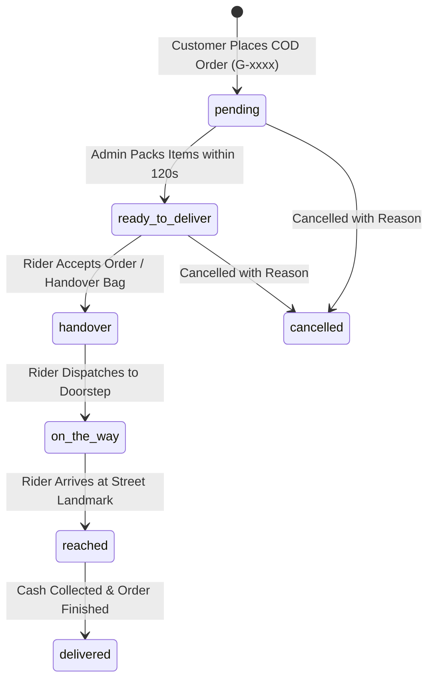

# GOZI QUICK-COMMERCE ARCHITECTURE & PROJECT HISTORY

**Hyperlocal Quick-Commerce Platform for Hetauda, Makwanpur, Nepal**
*Last Rebuilt & Hardened: 2026-11-25*

---

## 1. System Overview & Multi-App Synergy
The Gozi ecosystem consists of three synchronized client applications sharing a single, optimized Cloud Firestore database (`gozi-4d81e`):
1. **Gozi Web & Admin Operations Portal (`gozi-web`)**:
   - Public landing page (`/`), policy pages (`/about`, `/privacy-policy`, `/refund-policy`, `/terms`).
   - Protected Admin Command Center (`/admin`) for store dispatch, catalog management, finance, and rider payouts.
2. **Gozi Consumer Mobile App (`gozi-consumer-app`)**:
   - Fast React Native (Expo) app for customer ordering with Blinkit-style category grids, 3-column curated combo shelves, and real-time delivery tracking.
3. **Gozi Rider App (Targeted Architecture)**:
   - Dedicated delivery app where fleet riders log in via unique `loginId` + `loginPin`, view assigned pickup bags in `ready_to_deliver`, accept handover, and mark orders delivered with COD payment collection.

---

## 2. Sequential Order & Product ID Architecture
All three apps share unified, human-readable auto-incrementing identifiers maintained atomically in `settings/counters`:
- **Orders**: `G-1001`, `G-1002`, `G-1003`...
- **Products**: `P-1001`, `P-1002`, `P-1003`...
- **Riders**: `RIDER-01`, `RIDER-02`...

Implementation uses Firestore `runTransaction` to guarantee zero duplicate IDs across concurrent checkouts.

---

## 3. End-to-End Order Status Lifecycle Pipeline


- **Exact 5-Second Single Buzz Alert**: When a new order arrives with status `pending`, an alert chime sounds for exactly 5000ms using Web Audio API and auto-terminates.
- **Quota-Safe Snapshot**: Real-time listeners bind strictly to non-terminal orders (`where('status', 'in', ['pending', 'ready_to_deliver', 'handover', 'on_the_way', 'reached'])`). Delivered and cancelled orders are fetched on-demand or targeted by `deliveredDate: 'YYYY-MM-DD'`.

---

## 4. Firestore Database Schema

### `settings/counters`
```typescript
{
  lastOrderNumber: number;   // 1000 -> 1001
  lastProductNumber: number; // 1000 -> 1001
  lastRiderNumber: number;   // 0 -> 1
  updatedAt: string;
}
```

### `settings/appConfig`
```typescript
{
  isStoreOpen: boolean;
  deliveryFee: number;            // Rs. 30
  freeDeliveryAbove: number;      // Rs. 500
  minOrderValue: number;          // Rs. 99
  estimatedMinutesText: string;   // "10-15 mins"
  catalogVersion: number;         // Increments on any catalog edit to refresh client cache
  sectionOrder: string[];         // Array of Section IDs defining storefront order
  cloudinaryConfig: {
    cloudName: string;
    uploadPreset: string;
    enabled: boolean;
  }
}
```

### `sections/{sectionId}` (Level 1)
```typescript
{
  id: string;
  name: string;               // e.g. "Grocery & Kitchen", "Late Night Combos"
  slug: string;
  displayOrder: number;
  isActive: boolean;
  isCuratedShelf: boolean;    // true for 3-column product grid shelves
  shelfType: 'standard' | 'combos' | 'frozen' | 'trending';
  description: string;
}
```

### `categories/{categoryId}` (Level 2)
```typescript
{
  id: string;
  name: string;               // e.g. "Atta, Rice & Dal"
  slug: string;
  sectionId: string;
  sectionName: string;
  imageUrl: string;           // Direct image upload (<150KB WebP)
  displayOrder: number;
  isActive: boolean;
}
```

### `products/{productId}` (Level 3)
```typescript
{
  id: string;
  productNumber: string;      // "P-1001"
  name: string;
  description: string;
  sectionId: string;
  categoryId: string;
  unit: string;               // "1 kg", "500 ml", "Combo Set"
  mrp: number;
  sellingPrice: number;
  costPrice: number;          // For net profit calculation
  discountPercent: number;
  stockQuantity: number | null; // null = unlimited, int = auto-decrement
  inStock: boolean;
  images: string[];
  isTrending: boolean;
  isCombo: boolean;
  isFrozen: boolean;
  feedPriority: number;       // 1 - 100
  totalSold: number;
  totalRevenue: number;
}
```

### `riders/{riderId}`
```typescript
{
  id: string;
  riderNumber: string;        // "RIDER-01"
  name: string;
  phone: string;
  address: string;
  vehicleNumber: string;
  loginId: string;            // Rider App credentials
  loginPin: string;
  commissionType: 'fixed' | 'percentage';
  commissionRate: number;     // Rs. 35/delivery
  status: 'online' | 'busy' | 'offline';
  todayDeliveries: number;
  totalDeliveries: number;
  unpaidBalance: number;
  totalEarnings: number;
  payoutHistory: Array<{
    id: string;
    amount: number;
    paymentMethod: 'Cash' | 'eSewa' | 'Khalti' | 'Bank Transfer';
    note: string;
    createdAt: string;
  }>;
}
```

### `analytics/daily_{YYYY-MM-DD}` (Quota-Safe Financial Reporting)
```typescript
{
  date: string;               // "2026-11-25"
  totalOrders: number;
  deliveredOrders: number;
  cancelledOrders: number;
  totalRevenue: number;
  totalDeliveryFees: number;
  totalProfit: number;
  totalPiecesSold: number;
  productsSold: {
    [productId: string]: {
      productId: string;
      name: string;
      categoryName: string;
      qty: number;
      revenue: number;
      profit: number;
    }
  }
}
```

---

## 5. Security & Authentication Architecture
- **Primary Permanent Owners**:
  - `raghurl.2072@gmail.com`
  - `raghurl.202@gmail.com`
- **Dynamic Admins**: Any additional managers added via Admin Panel stored at `admins/{email}` (`active: true`).
- **Account Selection Enforced**: Google Auth popup uses `prompt: 'select_account'` and `auth_type: 'rerequest'` so users can switch between multiple Google accounts on the same machine without browser cache lockouts.
- **Rules Hardened**:
  - Server-side token validation: `request.auth.token.email.lower() == 'raghurl.2072@gmail.com'`.
  - Client-side code injection cannot bypass rules.
